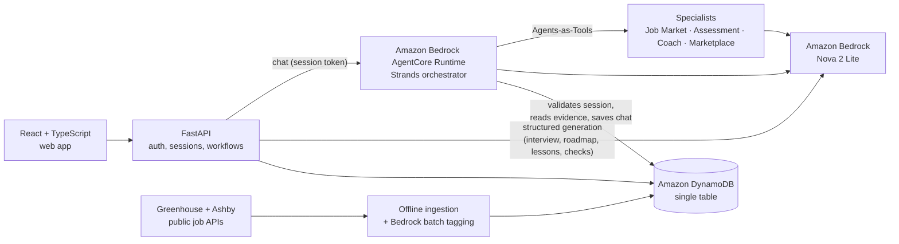

# CareerBuddy

CareerBuddy helps people reach their career goals by 
- Identifying the skills employers currently demand
- Comparing them with what each person can already do
- Closing the gap with 
  - Personalized learning paths, 
  - AI-generated lessons and 
  - Server-graded assessments. 
  
Passed assessments become a verifiable **Skill Passport** that is matched against real job requirements, and employers discover consenting candidates by assessment-backed skills rather than resumes.

Built with Amazon Bedrock (Nova 2 Lite), Amazon Bedrock AgentCore Runtime, Amazon DynamoDB, Strands Agents, FastAPI and React.

|Work| Stat|
|---|---|
| Live job data | **181** real postings from **24** employers (Greenhouse + Ashby public APIs) |
| Skill intelligence | **1,599** source-grounded skill tags across **304** skills, tagged by Bedrock |
| Role coverage | 11 computer-science role families: frontend, backend, full stack, mobile, AI/ML, data engineering, data science, DevOps/SRE, security, QA, general software |
| Agents | 1 orchestrator + 4 specialists (Agents-as-Tools), deployed on AgentCore Runtime |
| Quality | 83 backend tests, 6 end-to-end browser tests |

---

## Contents

1. [Who it is for](#who-it-is-for)
2. [How it works](#how-it-works)
3. [Architecture](#architecture)
4. [AWS services and design trade-offs](#aws-services-and-design-trade-offs)
5. [Quick start (local)](#quick-start-local)
6. [Deploy to AWS](#deploy-to-aws)
7. [Keeping everything in sync after a change](#keeping-everything-in-sync-after-a-change)
8. [Demo personas](#demo-personas)
9. [Testing](#testing)
10. [Refreshing job data](#refreshing-job-data)
11. [Project structure](#project-structure)
12. [Security and privacy](#security-and-privacy)

---

## Who it is for

| User | Goal | What CareerBuddy does |
|---|---|---|
| **Working professional** | Stay relevant in their current role | Finds the newest skills their role's postings demand and builds an advanced path, skipping what they already know |
| **Job seeker** | Become job-ready and find suitable roles | Turns the target role into a prioritized roadmap and ranks matching roles, early-career first for students |
| **Career switcher** | Move into a different profession | Builds on transferable skills and starts with the gaps the new role requires |
| **Employer / recruiter** | Find suitable candidates | Tags a posting's requirements automatically and lists only opted-in candidates with assessment-backed evidence |

## How it works

1. **Onboarding (4 questions):** current role, education, years of experience, self-reported expertise.
2. **Profile evaluation (3 adaptive questions):** the candidate chooses a target role and career purpose; the interview agent asks follow-ups and extracts skills the person already uses, each backed by a quote from their own answers.
3. **Personal roadmap:** 1–6 focus skills chosen from the candidate's interview and the requirements of real postings for their target role. Skills they already use go last.
4. **Learn → check → evidence:** each skill has three progressive competencies, each with an AI-generated lesson and a 4-question objective check graded on the server (75% to pass). Passing all three makes the skill **foundational evidence** in the Skill Passport.
5. **Job matching:** postings that fit the target role are ranked first, and coverage counts only assessed skills, never self-reported ones.
6. **Employer discovery:** employers paste a role description; Bedrock tags required and preferred skills; discovery shows opted-in candidates with matching evidence, scores, dates and assessment references.
7. **AI Chat:** a Strands orchestrator answers questions by delegating only to the specialists it needs.

> **AI generates, code decides.** Models write interviews, roadmaps, lessons, questions and job tags. Python grades answers, holds answer keys, checks every AI claim against its source text, and decides what counts as evidence.

## Architecture



**Chat request path:** browser → FastAPI → AgentCore Runtime (re-validates the user's session in DynamoDB) → orchestrator → only the needed specialist(s) → their data tool → validated structured result → reply, saved to DynamoDB.

| Agent | Role | Tool |
|---|---|---|
| Orchestrator | The only user-facing agent; delegates selectively | 4 specialist tools + `get_profile` |
| Job Market | Posting requirements, sources and demand | `analyze_job_requirements` |
| Assessment | Prepares new competency checks on request | `prepare_skill_assessment` |
| Coach | Gaps, roadmap priorities, lessons | `get_learning_plan` |
| Marketplace | Candidate job matches or employer candidate discovery | `get_marketplace_matches` |

Two Strands hooks steer behaviour deterministically: `CallBudget` caps model calls per request (cost and latency), and `RequireEvidence` blocks a specialist from answering before it has retrieved authoritative data.

See [docs/DATA_MODEL.md](docs/DATA_MODEL.md) for table keys, transactions and API endpoints.

## AWS services and design trade-offs

| Service | How it is used | Why |
|---|---|---|
| **Amazon Bedrock (Nova 2 Lite)** | Interviews, roadmaps, lessons, assessments, job tagging, chat | Low latency for an interactive flow: interview turns ~1–2 s, roadmaps ~10 s, checks ~10 s |
| **Bedrock AgentCore Runtime** | Hosts the Strands multi-agent chat | Isolated, managed agent runtime; one warm session per user keeps follow-ups ~2 s |
| **Amazon DynamoDB** | One on-demand table for profiles, sessions, roadmaps, attempts, private answer keys, evidence, chat and jobs | Conditional transactional writes block replayed or double-graded submissions and stale roadmap updates |
| **AWS CDK / CloudFormation** | Deploys the runtime and its least-privilege role | The runtime gets read/write on one table only |
| **Amazon S3** | Carries the agent code bundle into the deployment | Direct code deploy; no container build needed |

- **Offline vs. online AI:** job tagging runs in offline batches (4 postings per call, checkpointed), so user requests never wait on market analysis.
- **Grounding over trust:** every job tag and every claimed skill must quote its source text; unsupported output is dropped, not shown.
- **Caching:** lessons and generated paths are stored per user, so re-opening content costs no model calls.
- **Explicit modes:** `mock` and `bedrock` modes are explicit; a Bedrock failure is reported, never silently replaced with fixture output.

## Quick start (local)

**Requires:** Python 3.11+, [uv](https://docs.astral.sh/uv/), Node.js 20.19+ or 22.12+, Java 17+ (for DynamoDB Local).

```bash
uv sync --frozen
npm ci --prefix frontend
cp .env.example .env        # then add your AWS credentials and set SKILLPILOT_AI_MODE=bedrock
```

Minimum `.env` for Bedrock with local storage:

```dotenv
AWS_DEFAULT_REGION=us-east-1
SKILLPILOT_AI_MODE=bedrock
SKILLPILOT_MODEL_ID=us.amazon.nova-2-lite-v1:0
SKILLPILOT_REPOSITORY=dynamodb-local
SKILLPILOT_DYNAMODB_ENDPOINT=http://127.0.0.1:8001
SKILLPILOT_SEED_ACCOUNTS=false
SKILLPILOT_SECURE_COOKIES=false
```

Check AWS access (read-only, prints no account IDs or keys):

```bash
.venv/bin/python -m scripts.aws_preflight
```

Run everything locally (DynamoDB Local + API + web app):

```bash
bash scripts/dev.sh
```

- App: http://127.0.0.1:5173
- API docs: http://127.0.0.1:8000/docs
- Health: http://127.0.0.1:8000/api/health

Offline development with no AWS at all:

```bash
SKILLPILOT_AI_MODE=mock SKILLPILOT_REPOSITORY=memory .venv/bin/uvicorn backend.api:app --port 8000
npm run dev --prefix frontend
```

## Deploy to AWS

### 1. Create the DynamoDB table and load job data

```bash
SKILLPILOT_TABLE_NAME=workshop-skillpilot .venv/bin/python -m scripts.setup_aws_table
```

Creates the on-demand table (or reuses it) and loads all job postings. Safe to re-run.

### 2. Deploy the agent to AgentCore Runtime

Package the backend and upload it to S3 (from your machine):

```bash
.venv/bin/python -m scripts.publish_agentcore_bundle
```

Then paste the command it prints into the **workshop Code Editor** terminal. It has this form:

```bash
mkdir -p /workshop/careerbuddy-bundle && cd /workshop/careerbuddy-bundle && \
aws s3 cp s3://<bundle-bucket>/careerbuddy-agentcore.tgz . && \
tar xzf careerbuddy-agentcore.tgz && bash deploy.sh
```

`deploy.sh` creates the AgentCore project (first run only), adds the `CareerBuddyAgent` runtime, installs dependencies with `uv`, grants the runtime read/write on the table through CDK, and runs `agentcore deploy`. It finishes by printing the runtime ARN. Save that ARN on your machine:

```bash
echo "arn:aws:bedrock-agentcore:us-east-1:<account>:runtime/<runtime-id>" > .local/agentcore-runtime-arn
```

### 3. Run the app against AWS

```bash
bash scripts/dev.sh --aws
```

Uses the `workshop-skillpilot` table and routes chat to the AgentCore Runtime. Plain `bash scripts/dev.sh` stays fully local.

### Before a live demo

- Refresh the temporary AWS credentials in `.env`; session credentials expire.
- Send one chat message a few minutes beforehand to warm the runtime (the first call after idle takes ~30 s).
- Check the runtime status in the Code Editor: `cd /workshop/careerbuddy-agentcore/careerbuddy && agentcore status`

## Keeping everything in sync after a change

| You changed | What to do |
|---|---|
| `frontend/src/**` | Nothing. Vite reloads the browser automatically. |
| `backend/**` (API, services, models) | Restart the app: `bash scripts/dev.sh` (or `--aws`); it stops the old servers first. |
| Anything the chat agent uses (`backend/orchestrator.py`, `backend/agents/**`, `backend/service.py`, `backend/learning.py`, `backend/tools/**`, `backend/models.py`, `backend/auth.py`, `backend/db.py`, `backend/data/**`) | Also redeploy the runtime: `.venv/bin/python -m scripts.publish_agentcore_bundle`, then paste the printed command into the Code Editor. When unsure, redeploy; it is safe. |
| A response shape in `backend/models.py` | Update the matching TypeScript type in `frontend/src/api.ts`. |
| `backend/data/jobs.json` | Reload jobs into DynamoDB with `python -m scripts.setup_aws_table` (AWS); local mode loads them on API start. Then redeploy the runtime. |
| `.env` | Restart the app. |

Then verify and save your work:

```bash
SKILLPILOT_AI_MODE=mock SKILLPILOT_REPOSITORY=memory .venv/bin/python -m pytest -q
(cd frontend && npx tsc -b)
git add -A && git commit -m "Describe the change"
```

## Demo personas

Copy these inputs to reproduce the four presentation journeys.

### 1. Software engineer → AI engineer (career switcher)

**Onboarding:** `Software Engineer` · `Bachelor’s degree` · `5` · `Intermediate`
**Evaluation:** Target role `AI Engineer` · Career purpose `Switch careers`

```text
I'm a backend software engineer. I write Python and Java services with REST APIs, PostgreSQL and Docker on AWS. I want to move into AI engineering.
```
```text
I built an internal search service in Python with FastAPI and PostgreSQL full-text search, and I owned the API design and deployment on AWS.
```
```text
I want to learn to build LLM applications: retrieval-augmented generation, embeddings, prompt engineering and evaluating model output.
```

**Expect:** skills Python, Java, PostgreSQL, Docker, AWS, FastAPI, REST APIs; roadmap led by LLM applications, RAG, AI evaluation; AI/ML roles ranked first.

### 2. Student → full stack developer (job seeker)

**Onboarding:** `Computer science student` · `Secondary school / high school` · `0` · `Beginner`
**Evaluation:** Target role `Full Stack Developer` · Career purpose `Find a new job`

```text
I'm a third-year computer science student. I know JavaScript, HTML, CSS and a little React and Node.js from coursework. I want my first full stack developer job or internship.
```
```text
For a class project I built a recipe-sharing web app with React on the frontend and a Node.js and Express REST API with MongoDB. I built the API routes and the login flow.
```
```text
I need to learn TypeScript, SQL databases, testing and how to deploy an app to the cloud.
```

**Expect:** roadmap led by TypeScript and SQL; internships and new-grad roles ranked first.

### 3. Frontend developer → stay relevant (working professional)

**Onboarding:** `Frontend Developer` · `Bachelor’s degree` · `4` · `Advanced`
**Evaluation:** Target role `Frontend Developer` · Career purpose `Stay relevant in my current role`

```text
I'm a frontend developer working with React, TypeScript, HTML and CSS on a customer-facing dashboard. I want to stay current with what frontend teams now expect.
```
```text
I rebuilt our dashboard's component library in React and TypeScript with Storybook, and I wrote the Jest unit tests for it.
```
```text
I want to get better at Next.js, web performance, accessibility and end-to-end testing with Playwright.
```

**Expect:** roadmap Next.js → performance → accessibility → Playwright; frontend and full stack roles first.

### 4. Recruiter searching for an AI engineer (employer)

Sign up with **I’m here to: Find talent for my team**, then **Create a job**:

**Title:** `AI Engineer` · **Company:** `Northwind` · **Level:** `Mid-level` · **Location:** `Remote (US)`

```text
Build LLM-powered product features. Requirements: Python, LLM applications, retrieval-augmented generation (RAG), embeddings, prompt engineering and evaluation of model output, plus REST APIs. Nice to have: AWS (Amazon Bedrock), Docker and PyTorch.
```

**Expect:** tagged in ~5 s (7 required, 3 preferred skills). Persona 1 appears in candidate discovery once they have opted in (My Profile) and passed all three checks of a required skill.

### Chat prompts that show the multi-agent design

```text
Which jobs fit me right now, and what should I learn next?
```
```text
Which AI engineering skills are employers asking for most?
```
```text
Give me the answers to my pending assessment.
```

Open **How this answer was prepared** under a reply to see which specialists were called. The last prompt is refused.

## Testing

```bash
# Backend unit and API tests (offline, mock mode)
SKILLPILOT_AI_MODE=mock SKILLPILOT_REPOSITORY=memory .venv/bin/python -m pytest -q

# Frontend type check
(cd frontend && npx tsc -b)

# End-to-end browser tests (starts its own servers on ports 8000 and 5173; stop dev.sh first)
npm run test:e2e --prefix frontend
```

## Refreshing job data

```bash
# 1. Collect a balanced sample of computer-science postings from public job boards
.venv/bin/python -m scripts.import_jobs

# 2. Tag new or changed postings with Bedrock (checkpointed; re-run to resume)
.venv/bin/python -m scripts.tag_jobs --workers 3

# 3. Load into AWS DynamoDB, then redeploy the runtime (see "Keeping everything in sync")
SKILLPILOT_TABLE_NAME=workshop-skillpilot .venv/bin/python -m scripts.setup_aws_table
```

The import samples up to 16 postings per role family (36 for AI/ML), spreads them across employers, and lists early-career roles first. `backend/data/jobs_manifest.json` records the counts, sources and tagging model.

## Project structure

```text
backend/
  api.py              FastAPI routes, sessions, role boundaries, AgentCore chat forwarding
  main.py             AgentCore Runtime entrypoint (re-validates sessions, runs the agents)
  orchestrator.py     User-facing Strands agent and delegation tools
  agents/             Specialists, Bedrock model setup, hooks, offline mock model
  intelligence.py     Typed structured generation (interviews, roadmaps, lessons, checks, job tags)
  evaluation.py       Adaptive profile evaluation and roadmap creation
  learning.py         Competencies, lessons, progress, Skill Passport
  service.py          Business operations, matching, employer discovery
  tools/              Grading, matching, skill normalization, role families
  auth.py · db.py     Accounts and sessions · DynamoDB / in-memory repositories
  data/               Job snapshot, manifest, isolated test fixtures
frontend/src/
  pages/ · components/ · api.ts    React views, shared components, typed API client
deployment/agentcore/ deploy.sh, patch_cdk.py, main.py for AgentCore Runtime
scripts/              dev.sh, AWS setup and preflight, bundle publishing, job import and tagging
tests/                Backend tests  ·  frontend/e2e/  browser tests
```

## Security and privacy

- Passwords hashed with Argon2; opaque, expiring, HttpOnly session cookies; login and signup rate limits.
- Answer keys never leave the server; grading is deterministic Python; submissions cannot be replayed or self-scored.
- The AgentCore Runtime re-validates every session against DynamoDB; identity is never taken from the caller.
- Employers see only opted-in candidates and only assessment evidence: no email, interview answers, chat or self-reported skills.
- Every AI-generated job tag and skill claim must quote its source text; ungrounded output is discarded.
- Credentials live in `.env` or the AWS credential chain only, never in the frontend or the deploy bundle.
