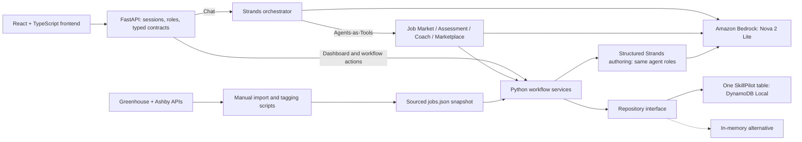

# CareerBuddy

CareerBuddy helps candidates understand their current skills, build a learning plan toward their chosen role, demonstrate progress through assessments, and compare that evidence with real job requirements. Employers can create postings and discover consenting candidates with relevant evidence.

Built for the BuilderWars AWS Hackathon with **React, TypeScript, Vite, Tailwind CSS, FastAPI, Strands Agents, Amazon Bedrock, and one DynamoDB table**. The product is named CareerBuddy; internal configuration uses `SKILLPILOT_*` and the table is named `SkillPilot`.

## Current features

### Accounts, onboarding, and profile

- Email/password signup and login for candidates and employers; Argon2 password hashing and expiring, revocable sessions.
- No target role or career purpose is assigned at signup. Four numbered onboarding questions: current role, highest education, experience from 0–30 years, and one of four self-reported expertise levels.
- Saved onboarding progress across reloads. Completion saves background only; it creates no assessment or roadmap.
- Current role, target role, self-reported skills, and career purpose: stay relevant, find a job, or switch careers.
- Private records attached to the authenticated account. Candidate discovery is off until the candidate opts in.
- No precreated accounts or fictional profiles in normal startup. Test fixtures require explicit opt-in.

### Home and navigation

- New candidates start with an empty workspace and **Evaluate my profile** as the first action.
- Once a roadmap exists, Home shows the next learning action, roadmap progress, Skill Passport, and sourced opportunities.
- Profile evaluation takes priority over legacy pending assessments. Assessment reminders use the active roadmap/evaluation.
- Candidate navigation: **Home**, **AI Chat**, **Learning**, **Assessments**, and **Jobs**. **My Profile** sits beside account controls.
- Employers have a separate **Hiring workspace** and **AI Chat**.
- Responsive dark/light themes, readable typography, rendered Markdown, and animated generation feedback with reduced-motion support.

### Profile evaluation and roadmap

- A separate **three-question, numbered learning evaluation** first collects an explicit target role and career purpose, then asks dynamic follow-ups about skills, projects, and goals through Strands and Bedrock.
- Candidates review the proposed role, goal, and self-reported skills before confirming. Skill claims require supporting excerpts from their answers.
- Coach selects and orders one to six focus skills using the chosen role, interview, background, and assessment evidence. Matching job-title requirements are used when available; other roles receive general learning guidance without market-demand claims.
- Confirmation generates the first three-competency path and saves a versioned personal roadmap. Other focus skills can be expanded on demand.
- **Re-evaluate profile** starts a new interview. The existing roadmap remains available until the replacement succeeds.
- Replacement roadmaps use new topic IDs; old assessment history and evidence remain saved. Progress counts generated competencies only.
- Interviews resume after interruption; stale submissions and duplicate confirmations are rejected. Generation failures preserve saved progress.

### Learning and coaching

- Three progressive knowledge/scenario competencies per expanded skill.
- On-demand personal lessons with explanations, examples, takeaways, and practice exercises.
- Private cached content, competency progress, lesson resumption, and a learning → assessment → feedback → reassessment cycle.
- Coaching reads the candidate's evidence and active roadmap. Before evaluation, it directs candidates to complete their learning profile.
- Practicing a lesson alone does not create assessed skill evidence.

### Assessments and Skill Passport

- Personalized four-question objective assessments generated with Strands and Bedrock.
- Private server-held answer keys; deterministic Python grading with feedback and a 75% pass threshold.
- Standalone skill checks and narrow competency checks, with retry options and attempt history.
- All three competency passes are required for a path to support broader Foundational skill evidence. A later failed competency can invalidate that aggregate.
- Passport entries include dates, scope, results, and supporting assessment references.
- Users cannot submit their own scores, change assessment-backed records, or replay a completed submission. Outdated competency attempts cannot overwrite current-roadmap evidence.

### Job intelligence and candidate marketplace

- **68 sourced job postings from nine employers**, collected through free Greenhouse and Ashby APIs and stored directly in the project.
- All 68 are tagged: **574 source-grounded skill tags across 106 distinct skills**, with required/preferred classifications, original URLs, and retrieval dates.
- Search and career-stage filtering, including eight internship/entry-level postings. The initial stage filter is All; student status does not silently select early-career jobs.
- Explainable supported and missing requirements based on passed assessment evidence; self-reported skills do not count toward coverage.
- Job details expose source excerpts and original application links. Public job listings are shared market data, not other candidates' private records.
- Manual import/tagging scripts refresh the snapshot; employer-created postings are analyzed when saved.

### Employer marketplace

- Create a job posting with title, company, level, location, and description.
- Dynamically extract and tag skills before saving the posting.
- List owned postings and discover opted-in candidates with relevant passing assessment evidence.
- Inspect supported requirements, gaps, evidence scope, dates, and attempt references.
- Ownership and current consent are checked on every discovery request. Candidate answers, chat, and learning history stay private.

### AI chat and multi-agent system

- One user-facing orchestrator delegates selectively to four real Strands specialist agents using **Agents-as-Tools**.
- Job-market questions, requested assessments, coaching, and marketplace requests invoke the relevant specialist rather than every agent.
- Structured specialist results and delegation traces; private conversation history persists across login and API restarts with DynamoDB.
- Latest 24 text messages are stored; the latest 12 provide model context. Private tool payloads and answer keys are excluded from chat history.
- Explicit mock mode exercises the Strands agent/tool loops without Bedrock inference. Bedrock failures never silently switch to mock responses.

## Overall architecture

The app runs locally as a Vite frontend, one FastAPI process, and DynamoDB Local. All agents execute inside the backend process. Bedrock provides remote model inference; AgentCore is prepared for later deployment and is outside the current request path.



**Chat execution:** authenticated request → orchestrator → selected specialist tool → authorized workflow/data tool → validated structured result → orchestrator reply.

**Learning execution:** four-question background onboarding → empty Home → three-question dynamic evaluation → reviewed claims/goal → Coach-selected roadmap → generated competencies and lessons → server-graded assessments → evidence and matching updates. Dashboard reads do not generate a new personal roadmap.

Form-driven workflows call the Python services and structured Strands generation directly. They do not simulate a chat request or invoke every specialist. Model output is validated before storage; Python controls authorization, persistence, grading, and matching.

### Agents, tools, hooks, and state

| Agent role | When it works | Custom tools |
| --- | --- | --- |
| Orchestrator | User chat and selective delegation; structured learning interview | Four specialist delegation wrappers and `get_profile` |
| Job Market Intelligence | Job requirements, sources, demand; structured posting tags | `analyze_job_requirements` |
| Skill Assessment | Explicit quiz requests; structured question authoring | `prepare_skill_assessment` |
| Skill Coach | Profile gaps, roadmap priorities, competencies, lessons | `get_learning_plan` |
| Marketplace | Candidate job matches or employer candidate discovery | `get_marketplace_matches` |

- **5 agent roles, 9 custom Strands tools:** four delegation wrappers, one profile tool, four specialist data tools. Structured-output helpers and REST endpoints are not extra business tools.
- **2 hook types:** `CallBudget` bounds model calls; `RequireEvidence` requires specialist data retrieval before a summary. These hooks provide deterministic workflow steering.
- **State:** HttpOnly authentication cookies plus repository-backed sessions, interviews, chat, roadmaps, and evidence. Agent instances are short-lived; the application stores durable state rather than a Strands session manager.
- No runtime skill packages or `SKILL.md`-loaded agent skills. Role prompts and Python hooks define behavior; there is no separate steering service.

### Persistence and access boundaries

One table contains profiles, hashed credentials, session digests, job records, onboarding/evaluation state, career paths, lessons, assessment attempts, private keys, evidence, and derived matches. User-owned records live under `USER#<id>`; public and employer-owned jobs use `JOB#<id>`.

Pending-attempt conditions and revision guards protect atomic updates, replay prevention, and concurrent grading. Repository implementations cover DynamoDB, DynamoDB Local, and memory. The selected mode is explicit; a storage failure does not silently switch to memory.

See [data model and API reference](docs/DATA_MODEL.md) for keys, transactions, and endpoint groups.

### Source structure

```text
backend/
  api.py              FastAPI routes, authenticated identity, role boundaries
  auth.py             Passwords, sessions, attempt limits
  orchestrator.py     User-facing agent and delegation tools
  agents/             Specialists, model providers, hooks, mock model
  intelligence.py     Typed Strands authoring for interviews/content/job tags
  onboarding.py       Four background questions and saved progress
  evaluation.py       Adaptive learning evaluation and roadmap replacement
  learning.py         Competencies, lessons, progress, Skill Passport
  service.py          Authorized business operations and derived data
  tools/              Deterministic grading, matching, skill normalization
  conversation.py     Private persisted text history
  db.py               Memory and single-table DynamoDB repositories
  models.py           Strict Pydantic request/output schemas
  data/               Sourced jobs, manifest, isolated test fixtures
  main.py             Prepared AgentCore entrypoint
frontend/src/
  pages/              Candidate and employer views
  components/         Chat, evaluation, assessment, Markdown, loaders, branding
  api.ts              Typed client contracts
scripts/              Local startup, AWS checks, job import/tagging, maintenance
tests/                Backend checks; frontend/e2e/ contains browser checks
deployment/           Prepared Dockerfile and pinned runtime requirements
```

## Local setup

Requires Python 3.11+, `uv`, npm, and a Vite-supported Node version (20.19+ or 22.12+). Java 17+ runs DynamoDB Local. Install dependencies from the repository root:

```bash
uv sync --frozen
npm ci --prefix frontend
```

On a new checkout, copy `.env.example` to `.env`. Keep an existing private `.env`. For Bedrock with persistent local storage, configure:

```dotenv
AWS_DEFAULT_REGION=us-east-1
SKILLPILOT_AI_MODE=bedrock
SKILLPILOT_MODEL_ID=us.amazon.nova-2-lite-v1:0
SKILLPILOT_REPOSITORY=dynamodb-local
SKILLPILOT_DYNAMODB_ENDPOINT=http://127.0.0.1:8001
SKILLPILOT_TABLE_NAME=SkillPilot
SKILLPILOT_SEED_ACCOUNTS=false
SKILLPILOT_SECURE_COOKIES=false
```

Use the standard AWS credential chain or the ignored `.env`. Temporary credentials need `AWS_ACCESS_KEY_ID`, `AWS_SECRET_ACCESS_KEY`, and `AWS_SESSION_TOKEN`. Never commit them or put them in browser-facing `VITE_*` variables. Enable secure cookies when serving through HTTPS.

```bash
bash scripts/dev.sh
```

This starts DynamoDB Local, creates only the local table if needed, and serves the API and frontend. Data persists under ignored `.local/dynamodb-data/`. Ctrl+C stops the processes the script started.

- Application: http://127.0.0.1:5173
- API/OpenAPI UI: http://127.0.0.1:8000/docs
- Health: http://127.0.0.1:8000/api/health

For offline, temporary in-memory development, run these in separate terminals:

```bash
SKILLPILOT_AI_MODE=mock SKILLPILOT_REPOSITORY=memory uv run uvicorn backend.api:app --host 127.0.0.1 --port 8000
```

```bash
npm run dev --prefix frontend
```

Memory mode resets accounts and records on restart. Mock mode can also be combined with DynamoDB Local for persistent offline development.

### AWS and model checks

The selected model is **Amazon Nova 2 Lite**, inference profile `us.amazon.nova-2-lite-v1:0`. Local account checks previously verified it in `us-east-1`, along with Nova Lite/Pro and focused specialist delegation. Temporary credentials and access can change; rerun preflight after renewal:

```bash
uv run aws --version
uv run python -m scripts.aws_preflight
```

Preflight checks CLI/SDK identity, lists Nova models, and makes a small inference call. It creates no infrastructure and saves a safe report in `.local/aws-preflight.json`. Python scripts load `.env`; bare AWS CLI commands do not load that file automatically. Model listing alone does not prove inference permission. The `us.` profile can route inference across supported US regions.

## Data and maintenance

The public snapshot covers Anthropic, Scale AI, Databricks, Figma, Hex, Cohere, Ramp, Perplexity, and Baseten. Counts and provenance live in [jobs_manifest.json](backend/data/jobs_manifest.json), [jobs.json](backend/data/jobs.json), and the [dataset reference](backend/data/README.md).

```bash
uv run python -m scripts.import_jobs
uv run python -m scripts.tag_jobs
```

Import requires no job-API key and refuses a replacement with fewer than 50 real postings. Tags for unchanged descriptions are retained. Tagging uses Bedrock inference; source excerpts are validated against saved descriptions. Restart the API to load a refreshed snapshot while retaining user records.

Six synthetic jobs, seven fictional profiles, and reference questions/lessons remain isolated test fixtures. They are disabled in normal startup. To remove known fixture identities and related data from an older **local** database:

```bash
uv run python -m scripts.remove_sample_accounts --dry-run
uv run python -m scripts.remove_sample_accounts
```

The utility targets known fixture IDs, preserving signup users and their evidence. It refuses non-loopback endpoints. Remove an obsolete ignored `.local/actor-accounts.json` after cleanup.

Brand assets live in `frontend/public/`; shared components are in `frontend/src/components/Brand.tsx`. After changing the master SVG, `node scripts/generate_brand_icons.mjs` regenerates favicon and app-icon exports using local Chrome/Playwright. The manifest does not provide offline application support.

## Validation

Latest recorded checks: **78 backend tests**, **6 browser tests** across desktop/mobile, and a successful TypeScript/Vite production build.

```bash
uv run pytest -q
npm run build --prefix frontend
# Requires Google Chrome and free ports 8000/5173; starts isolated mock services.
npm run test:e2e --prefix frontend
```

Coverage includes actual nested Strands routing/tool loops, grading, persistence, account/consent isolation, versioned evaluation and roadmap replacement, stale pending attempts, generation failure, and matching. Browser tests use explicit mock inference; they do not measure live model quality.

Optional integration checks:

```bash
# DynamoDB Local must be running.
uv run python -m scripts.local_persistence_smoke
# Also requires working Bedrock credentials; uses inference credits.
uv run python -m scripts.live_agents_smoke
```

Earlier focused live checks exercised Bedrock delegation and generated content with DynamoDB Local. A focused live Bedrock check generated a Writer roadmap and its first three competencies without market requirements. The complete learning-evaluation flow has been checked with mock inference and memory/DynamoDB repository tests; a full live Bedrock evaluation/redo check remains to be run. Private reports and screenshots stay in ignored `.local/`.

## Scope and deployment status

- Learning roadmaps can cover roles beyond AI engineering. The saved job dataset still focuses on AI engineering and related roles. Goals without matching saved job titles receive general guidance, and Home does not promote unrelated jobs as relevant opportunities. Editing a goal does not collect another occupation's dataset; snapshots can become stale and are not a market census.
- Objective quizzes award limited **Foundational** evidence. Coding/project grading and the **Applied/Demonstrated** levels are not implemented.
- Scheduled reminders, candidate invitations, application tracking, and complete recruiting workflows are not implemented.
- Email verification, password reset, MFA, independent employer verification, and distributed rate limiting are outside the current MVP.
- No AWS deployment has been performed. Local Bedrock inference is the only active cloud dependency.

`backend/main.py` wraps the orchestrator with `BedrockAgentCoreApp` and validates an existing application session. `deployment/Dockerfile` and pinned requirements prepare a backend image. The image has not been built or deployed; FastAPI-to-AgentCore forwarding is not enabled. Future deployment requires explicit approval, reviewed packaging/identity permissions, an existing single table, and `linux/arm64` packaging for AgentCore. Do not run provisioning or default templates that add services automatically.

## Project references

- [Data model and API](docs/DATA_MODEL.md): current persistence and endpoint reference.
- [Original SkillPilot architecture](docs/ARCHITECTURE.md): preserved project brief; describes intended scope, including deployment, rather than current delivery status.
- [Original CareerBuddy feature plan](docs/CAREERBUDDY_FEATURES.md): preserved requirements; includes later features. The implemented feature list is this README.
- [AWS Strands workshop](https://github.com/aws-samples/sample-strands-agents-hands-on-workshop): reference patterns for agent tools, steering, AgentCore, delegation, and evaluations.

Unknown background/goal values remain empty or `unspecified`. Legacy unconfirmed signup defaults are hidden from model/UI context until the user chooses a goal; stored assessment history is preserved. The AI-engineering job snapshot describes the available market sample rather than a user’s intended role.
